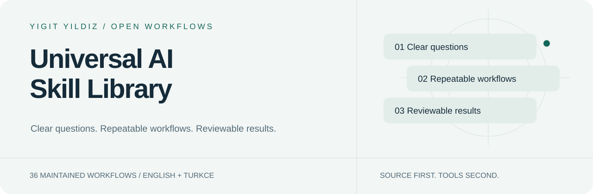

<picture>
  <source media="(prefers-color-scheme: dark)" srcset="assets/hero-dark.svg">
  
</picture>

# Universal AI Skill Library

[English](README.md) · [Türkçe](README.tr.md)

    

**Source-led workflows for development, design, research, clinical reasoning and everyday work.**

37 maintained entry points. Choose one for the job; do not load the entire library into context.

[Start here](docs/INSTALL.md) · [Browse the catalog](https://yigityildiz0.github.io/universal-ai-skill-library/) · [Downloads](DOWNLOADS.md) · [Maintenance model](MAINTAINING.md)

## New in 2026.10.14.2

- **presentation-studio** (new): complete editable PowerPoint decks — course rules as defaults, slide plan, real licensed photos, JS and Python deck kits, timed speaker notes with pronunciations, PowerPoint render QA, `pptx_audit.py` and a pre-talk reading guide.
- **pdf-studio** (new): reliable PDFs — intake questions, design languages, print-safe pagination (no split tables, stranded headings or overflow), lint + page audit, research-backed list of AI PDF failure modes.
- `slides` is renamed **html-slides** and only handles browser decks; PowerPoint requests route to presentation-studio.
- academic-study-coach, office-docs-qa, design and design-system now hand deck building to presentation-studio (fixes a broken PPTX QA link).
- Gemini packages (CLI folders and filtered Gemini app uploads), an installation table for every app and a real GitHub Release with SHA-256 checksums.
- One ZIP per skill for every app, never split into parts; Claude gets grouped bulk-upload ZIPs on the Desktop edition.

## Works with

| App | Package |
|---|---|
| Claude Code | portable folder → ~/.claude/skills |
| Claude.ai | one upload ZIP per skill |
| Codex / ChatGPT desktop | Codex.zip → ~/.codex/skills |
| ChatGPT web | plugin ZIP where the account offers import |
| Gemini CLI / app | ~/.gemini/skills · Skills upload (filtered copy) |
| OpenCode · DeepSeek Harness | portable folder + skills path |

Step-by-step: [Installation](docs/INSTALL.md). A file on disk is not proof of activation; test with one example request.

## Start with the work you want to do

<strong>Everyday workflows</strong> · 4

| Skill | What it helps with |
|---|---|
| [caveman](docs/skills/caveman.en.md) | Use official Caveman, Ultracave and Megacave modes for concise communication. |
| [personal-tech-copilot](docs/skills/personal-tech-copilot.en.md) | Troubleshoot everyday devices, apps and setup using the tools actually available. |
| [plan-smart-routes](docs/skills/plan-smart-routes.en.md) | Plan practical routes with mode choices, timing and honest live-data limits. |
| [purchase-advisor](docs/skills/purchase-advisor.en.md) | Compare product suitability, evidence and real total cost rather than promotional rankings. |

<strong>Learn & write</strong> · 4

| Skill | What it helps with |
|---|---|
| [academic-study-coach](docs/skills/academic-study-coach.en.md) | Turn course material into a study plan, active recall and literature-reading practice. |
| [office-docs-qa](docs/skills/office-docs-qa.en.md) | Check document structure, content and presentation with explicit verification boundaries. |
| [pdf-studio](docs/skills/pdf-studio.en.md) | Make reliable PDFs: intake questions first, print-safe HTML/CSS with design languages, rendered pages audited for split tables, stranded headings, overflow and broken letters. |
| [yigit-writer](docs/skills/yigit-writer.en.md) | Write and revise clear messages, articles and academic prose without changing factual meaning. |

<strong>Build software</strong> · 7

| Skill | What it helps with |
|---|---|
| [ai-agent-builder](docs/skills/ai-agent-builder.en.md) | Build, audit and maintain skills, agent workflows and MCP integrations. |
| [coding-workflow](docs/skills/coding-workflow.en.md) | Move from a code problem to a scoped implementation and verified result. |
| [context7-mcp](docs/skills/context7-mcp.en.md) | Retrieve current library documentation through an available Context7 integration. |
| [find-docs](docs/skills/find-docs.en.md) | Find authoritative documentation and identify the correct version and source. |
| [graphify](docs/skills/graphify.en.md) | Understand relationships across code, documents and research using a knowledge graph. |
| [modern-web-guidance](docs/skills/modern-web-guidance.en.md) | Choose current web patterns without forcing a new stack onto an existing project. |
| [super-memory](docs/skills/super-memory.en.md) | Keep compact, project-local handoffs and evidence across long sessions and different agents. |

<strong>Research & analyze</strong> · 5

| Skill | What it helps with |
|---|---|
| [ai-research-skills](docs/skills/ai-research-skills.en.md) | Navigate a broad ML engineering library for training, RAG, evaluation and experiments. |
| [data-analyst](docs/skills/data-analyst.en.md) | Analyze data with explicit units, missingness, assumptions and uncertainty. |
| [parallel-web](docs/skills/parallel-web.en.md) | Retain Parallel service documentation while routing this edition to existing no-extra-cost research tools. |
| [primary-source-research](docs/skills/primary-source-research.en.md) | Answer from official documents, specifications, source code and first-party records. |
| [research-analyst](docs/skills/research-analyst.en.md) | Coordinate quick or deep research, claim verification, synthesis and timestamped video analysis. |

<strong>Design & create</strong> · 13

| Skill | What it helps with |
|---|---|
| [ai-image-video-studio](docs/skills/ai-image-video-studio.en.md) | Plan and troubleshoot image/video production, including local ComfyUI workflows. |
| [banner-design](docs/skills/banner-design.en.md) | Compose banners around a real platform size, readable message and clear action. |
| [brand](docs/skills/brand.en.md) | Keep visual identity, voice and messaging consistent across deliverables. |
| [campaign-plan](docs/skills/campaign-plan.en.md) | Plan a campaign with audience, channels, content, resources and measurable outcomes. |
| [design](docs/skills/design.en.md) | Route a design task to the right brand, interface, icon, banner or slide workflow. |
| [design-system](docs/skills/design-system.en.md) | Connect design tokens, component specifications and audience-appropriate presentations. |
| [html-slides](docs/skills/html-slides.en.md) | Build browser-based HTML presentations with Chart.js, design tokens and responsive layouts; PowerPoint decks belong to presentation-studio. |
| [presentation-studio](docs/skills/presentation-studio.en.md) | Make complete, editable PowerPoint decks: course rules as defaults, slide plan, real licensed photos, a design kit, timed speaker notes with pronunciations, rendered QA and an audit. |
| [site-seo-audit](docs/skills/site-seo-audit.en.md) | Audit observable technical and content SEO without pretending recommendations were deployed. |
| [ui-styling](docs/skills/ui-styling.en.md) | Implement interface styling that respects the project’s existing components and tokens. |
| [ui-ux-pro-max](docs/skills/ui-ux-pro-max.en.md) | Search design intelligence across styles, palettes, typography, charts and platform stacks. |
| [web-animation](docs/skills/web-animation.en.md) | Apply GSAP/Motion patterns while preserving accessibility and existing integrations. |
| [web-ui-design](docs/skills/web-ui-design.en.md) | Design interfaces around real tasks, hierarchy, responsiveness and accessibility. |

<strong>Health & rehabilitation</strong> · 3

| Skill | What it helps with |
|---|---|
| [medical-evidence-research](docs/skills/medical-evidence-research.en.md) | Search, appraise and synthesize medical evidence, including rehabilitation and Türkiye applicability. |
| [mental-health-crisis-support](docs/skills/mental-health-crisis-support.en.md) | Support a calm, safety-oriented response to mental-health crisis signals. |
| [physio-clinical-copilot](docs/skills/physio-clinical-copilot.en.md) | Support clinician-reviewed rehabilitation reasoning, assessment and draft planning. |

<strong>Finance & decisions</strong> · 1

| Skill | What it helps with |
|---|---|
| [yigit-investment-copilot](docs/skills/yigit-investment-copilot.en.md) | Research BIST, TEFAS and US investments with valuation, scenarios and portfolio-risk checks. |

## What happens when a skill runs?

~~~mermaid
flowchart LR
 A[Your goal] --> B[Match the skill]
 B --> C[Load relevant module]
 C --> D[Use available tools]
 D --> E[Verify and explain]
~~~

This is the workflow, not a claim that tools ran or every result is verified. Each skill page explains an example request, trigger, mechanics, inputs/outputs and source modules.

## One source. Durable collections.

The canonical source is [Universal AI Skill Library](https://github.com/yigityildiz0/universal-ai-skill-library). Domain repositories are selected views of the same release—not independently edited forks. Existing links and history stay intact.

[All collections / Tüm koleksiyonlar](COLLECTIONS.md) · [Legacy/community resources](LEGACY.md) · [Licenses & provenance](docs/LICENSE-SCOPE.md)

## Honest scope

- Installing a skill does not train a model or connect an account/tool.
- Local files and a web-account import are different; follow the supported host flow.
- No automatic extra billed API or model download.
- The historical community catalog is not counted as maintained or claimed as runtime-tested.
- Source licenses remain attached; no blanket third-party license is assumed.

---
Maintained by [Yigit Yildiz](https://github.com/yigityildiz0) · Source edition 2026.10.14.2
