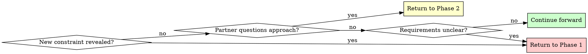

# Module: brainstorming

> Part of the `coding-workflow` skill. Paths below are relative to this module folder (`modules/brainstorming/`).
> Trigger scope: Use only when the user explicitly wants ideation, alternative exploration, or collaborative design refinement. Do not activate as a prerequisite for a clear implementation or bugfix request. Turkish triggers: fikir üret, birlikte düşünelim, seçenekleri geliştir, tasarımı birlikte netleştirelim.

# Brainstorming Ideas Into Designs

## Overview

Transform rough ideas into fully-formed designs through structured questioning and alternative exploration.

**Core principle:** Use existing context first, explore useful alternatives, and ask only material unanswered questions. No mandatory interview, approval loop, document, commit, or worktree.

**Announce at start:** "I'm using the brainstorming skill to refine your idea into a design."

## Quick Reference

| Phase | Key Activities | Tool Usage | Output |
|-------|---------------|------------|--------|
| **1. Understanding** | Read context; clarify material gaps only | A focused question when needed | Purpose, constraints, criteria |
| **2. Exploration** | Propose 2-3 approaches | Structured user input for approach selection, when available | Architecture options with trade-offs |
| **3. Design Presentation** | Concise recommendation and trade-offs | Feedback only where needed | Actionable design |
| **4. Design Documentation** | Save only if requested or warranted | Plain Markdown | Optional design record |
| **5. Worktree Setup** | Isolate only when needed | [using-git-worktrees](../using-git-worktrees/MODULE.md) | Optional isolated workspace |
| **6. Planning Handoff** | Scale plan to task | [writing-plans](../writing-plans/MODULE.md) | Executable next steps |

## The Process

Use the relevant items only; this is not a mandatory interview or artifact sequence:

```
Brainstorming Progress:
- [ ] Phase 1: Understanding (purpose, constraints, criteria gathered)
- [ ] Phase 2: Exploration (2-3 approaches proposed and evaluated)
- [ ] Phase 3: Design Presentation (recommendation and material decisions resolved)
- [ ] Phase 4: Design Documentation (only if requested or warranted)
- [ ] Phase 5: Worktree Setup (only if isolation is needed)
- [ ] Phase 6: Planning Handoff (if implementing)
```

### Phase 1: Understanding
- Check current project state in working directory
- Read available context first; ask a focused question only for a material unresolved detail
- Use the current host's structured user-input mechanism when multiple-choice options would help; otherwise present the choices directly
- Gather: Purpose, constraints, success criteria

**Example structured question:**
```
Question: "Where should the authentication data be stored?"
Options:
  - "Server session with Secure, HttpOnly, SameSite cookies" (limits script access; requires CSRF-aware design)
  - "Session storage" (tab lifetime, but script-readable and exposed to XSS)
  - "Local storage" (persistent and script-readable; avoid persisting sensitive credentials without a justified threat model)
```

### Phase 2: Exploration
- Propose 2-3 different approaches
- For each: Core architecture, trade-offs, complexity assessment
- Use the current host's structured user-input mechanism to present approaches when available, or present the same choices directly
- Recommend an approach; ask only if a material preference or constraint remains unresolved

**Example structured question:**
```
Question: "Which architectural approach should we use?"
Options:
  - "Event-driven with message queue" (scalable, complex setup, eventual consistency)
  - "Direct API calls with retry logic" (simple, synchronous, easier to debug)
  - "Hybrid with background jobs" (balanced, moderate complexity, best of both)
```

### Phase 3: Design Presentation
- Present a concise design sized to the problem
- Cover: Architecture, components, data flow, error handling, testing
- Invite feedback when it changes the outcome; no approval after every section
- Continue already-authorized implementation once material decisions are resolved

### Phase 4: Design Documentation
When a durable design record is requested or proportionate to the work:
- **File location:** `docs/plans/YYYY-MM-DD-<topic>-design.md` (use actual date and descriptive topic)
- **RECOMMENDED SUB-SKILL:** Use an installed writing or style skill, if available, to improve documentation quality
- **Content:** Capture the design as discussed and validated in Phase 3, organized into the sections that emerged from the conversation
- Commit only if explicitly requested or required by the repository's authorized workflow

### Phase 5: Worktree Setup (for implementation)
When isolation is needed for implementation, read [using-git-worktrees](../using-git-worktrees/MODULE.md). Reuse an appropriate existing workspace. Worktree creation is optional and not a design approval gate.

### Phase 6: Planning Handoff
If implementation was already requested, continue with an appropriately sized plan using [implementation-plan](../implementation-plan/MODULE.md) or [writing-plans](../writing-plans/MODULE.md), then execute. For ideation-only requests, deliver the design and recommendation; do not assume permission to implement.

## Question Patterns

### When to Use Structured User Input

**Use the host's structured user-input mechanism, when available, for:**
- Phase 1: Clarifying questions with 2-4 clear options
- Phase 2: Architectural approach selection (2-3 alternatives)
- Any decision with distinct, mutually exclusive choices
- When options have clear trade-offs to explain

**Benefits:**
- Structured presentation of options with descriptions
- Clear trade-off visibility for partner
- Forces explicit choice (prevents vague "maybe both" responses)

### When to Use Open-Ended Questions

**Use open-ended questions for:**
- Phase 3: Design validation ("Does this look right so far?")
- When you need detailed feedback or explanation
- When partner should describe their own requirements
- When structured options would limit creative input

**Example decision flow:**
- "What authentication method?" → Present 2-4 structured options with trade-offs
- "Does this design handle your use case?" → Open-ended (validation)

## When to Revisit Earlier Phases



**You can and should go backward when:**
- Partner reveals new constraint during Phase 2 or 3 → Return to Phase 1
- Validation shows fundamental gap in requirements → Return to Phase 1
- Partner questions approach during Phase 3 → Return to Phase 2
- Something doesn't make sense → Go back and clarify

**Don't force forward linearly** when going backward would give better results.

## Key Principles

| Principle | Application |
|-----------|-------------|
| **One question at a time** | Phase 1: Single question per message; use structured input for choices when available |
| **Structured choices** | Present 2-4 options with trade-offs through the host's supported interaction mechanism |
| **YAGNI ruthlessly** | Remove unnecessary features from all designs |
| **Explore alternatives** | Compare 2-3 genuinely useful approaches when choices matter |
| **Incremental validation** | Resolve material uncertainty without repetitive approvals |
| **Flexible progression** | Go backward when needed - flexibility > rigidity |
| **Announce usage** | State skill usage at start of session |
