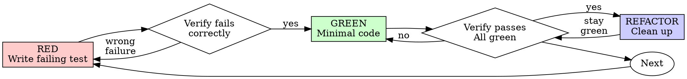

# Module: test-driven-development

> Part of the `coding-workflow` skill. Paths below are relative to this module folder (`modules/test-driven-development/`).
> Trigger scope: Test-first development when requested, required by the repository, or useful for behavior changes with meaningful regression risk. Turkish triggers: test güdümlü geliştirme, önce başarısız test sonra düzeltme, regresyon testi.

# Test-Driven Development (TDD)

## Overview

Write the test first. Watch it fail. Write minimal code to pass.

**Core principle:** If you didn't watch the test fail, you don't know if it tests the right thing.

Scale testing to risk and preserve existing user code. A reversible low-impact documentation/configuration edit may need only a targeted check; do not create tests that merely mirror the implementation.

## When to Use

**Prefer test-first work for meaningful behavior changes:**
- New features
- Bug fixes
- Refactoring
- Behavior changes

**Use proportionate verification rather than an automatic permission question for:**
- Throwaway prototypes
- Generated code
- Configuration files

Use the smallest check that meaningfully verifies the requirement; follow explicit repository test policy.

## The Iron Law

```
WHEN USING TDD: OBSERVE THE INTENDED FAILURE, IMPLEMENT, THEN OBSERVE PASSING BEHAVIOR
```

If implementation already exists, preserve it. Add meaningful behavior/characterization tests and reproduce the regression using a disposable copy or a precisely reversible isolated change when needed. Never delete user code, reset a branch, or restart working implementation merely to impose test-first chronology. Report honestly whether the test was written before or after the implementation.

## Red-Green-Refactor



### RED - Write Failing Test

Write one minimal test showing what should happen.

<Good>
```typescript
test('retries failed operations 3 times', async () => {
  let attempts = 0;
  const operation = () => {
    attempts++;
    if (attempts < 3) throw new Error('fail');
    return 'success';
  };

  const result = await retryOperation(operation);

  expect(result).toBe('success');
  expect(attempts).toBe(3);
});
```
Clear name, tests real behavior, one thing
</Good>

<Bad>
```typescript
test('retry works', async () => {
  const mock = jest.fn()
    .mockRejectedValueOnce(new Error())
    .mockRejectedValueOnce(new Error())
    .mockResolvedValueOnce('success');
  await retryOperation(mock);
  expect(mock).toHaveBeenCalledTimes(3);
});
```
Vague name, tests mock not code
</Bad>

**Requirements:**
- One behavior
- Clear name
- Real code (no mocks unless unavoidable)

### Verify RED - Watch It Fail

**MANDATORY. Never skip.**

```bash
npm test path/to/test.test.ts
```

Confirm:
- Test fails (not errors)
- Failure message is expected
- Fails because feature missing (not typos)

**Test passes?** You're testing existing behavior. Fix test.

**Test errors?** Fix error, re-run until it fails correctly.

### GREEN - Minimal Code

Write simplest code to pass the test.

<Good>
```typescript
async function retryOperation<T>(fn: () => T | Promise<T>): Promise<T> {
  for (let i = 0; i < 3; i++) {
    try {
      return await fn();
    } catch (e) {
      if (i === 2) throw e;
    }
  }
  throw new Error('unreachable');
}
```
Just enough to pass
</Good>

<Bad>
```typescript
async function retryOperation<T>(
  fn: () => Promise<T>,
  options?: {
    maxRetries?: number;
    backoff?: 'linear' | 'exponential';
    onRetry?: (attempt: number) => void;
  }
): Promise<T> {
  // YAGNI
}
```
Over-engineered
</Bad>

Don't add features, refactor other code, or "improve" beyond the test.

### Verify GREEN - Watch It Pass

**MANDATORY.**

```bash
npm test path/to/test.test.ts
```

Confirm:
- Test passes
- Other tests still pass
- Output pristine (no errors, warnings)

**Test fails?** Fix code, not test.

**Other tests fail?** Fix now.

### REFACTOR - Clean Up

After green only:
- Remove duplication
- Improve names
- Extract helpers

Keep tests green. Don't add behavior.

### Repeat

Next failing test for next feature.

## Good Tests

| Quality | Good | Bad |
|---------|------|-----|
| **Minimal** | One thing. "and" in name? Split it. | `test('validates email and domain and whitespace')` |
| **Clear** | Name describes behavior | `test('test1')` |
| **Shows intent** | Demonstrates desired API | Obscures what code should do |

## Why Order Matters

**"I'll write tests after to verify it works"**

Tests written after code may pass immediately. They can still verify behavior, but immediate success alone does not prove they detect the intended regression:
- Might test wrong thing
- Might test implementation, not behavior
- Might miss edge cases you forgot
- You never saw it catch the bug

Test-first forces you to see the test fail, proving it actually tests something.

**"I already manually tested all the edge cases"**

Manual testing is ad-hoc. You think you tested everything but:
- No record of what you tested
- Can't re-run when code changes
- Easy to forget cases under pressure
- "It worked when I tried it" ≠ comprehensive

Automated tests are systematic. They run the same way every time.

**"Deleting X hours of work is wasteful"**

Preserve working and user-authored code. Improve confidence with contract-based tests and a safe regression reproduction; discarding implementation is not a verification technique. Rewrite only when evidence and authorized scope justify it.

**"TDD is dogmatic, being pragmatic means adapting"**

TDD IS pragmatic:
- Finds bugs before commit (faster than debugging after)
- Prevents regressions (tests catch breaks immediately)
- Documents behavior (tests show how to use code)
- Enables refactoring (change freely, tests catch breaks)

The useful outcome is trustworthy behavior evidence, not ritual or guaranteed timing claims.

**"Tests after achieve the same goals - it's spirit not ritual"**

Tests before and after implementation can both assess requirements. Test-first helps expose assumptions early; later tests need care to avoid copying implementation details. Validate regression sensitivity safely. Do not call tests-after TDD, but do not dismiss valid evidence or delete code to change chronology.

## Common Rationalizations

| Excuse | Reality |
|--------|---------|
| "Too simple to test" | Match the check to meaningful behavior and regression risk; no universal time estimate. |
| "I'll test after" | Preserve the code; test the contract and establish regression sensitivity safely. |
| "Tests after achieve same goals" | Both can check requirements; later tests need independent cases and safe regression-sensitivity evidence. |
| "Already manually tested" | Ad-hoc ≠ systematic. No record, can't re-run. |
| "Deleting X hours is wasteful" | Do not delete code for chronology; improve verification. |
| "Keep as reference, write tests first" | Keep existing work and label the chronology accurately. |
| "Need to explore first" | Use a bounded spike; preserve useful/user work and verify the resulting behavior. |
| "Test hard = design unclear" | Listen to test. Hard to test = hard to use. |
| "TDD will slow me down" | TDD faster than debugging. Pragmatic = test-first. |
| "Manual test faster" | Manual doesn't prove edge cases. You'll re-test every change. |
| "Existing code has no tests" | You're improving it. Add tests for existing code. |

## Signals to Improve Verification

- A failure cannot be explained or is caused by broken setup rather than behavior.
- The test copies the implementation or only asserts mock call counts.
- A relevant boundary/error case is missing.
- A passing regression test has not been shown to detect the original bug.

Investigate and strengthen the checks without deleting existing work. Reproduce red only through a reversible isolated change or disposable copy; restore and verify the final state.

## Example: Bug Fix

**Bug:** Empty email accepted

**RED**
```typescript
test('rejects empty email', async () => {
  const result = await submitForm({ email: '' });
  expect(result.error).toBe('Email required');
});
```

**Verify RED**
```bash
$ npm test
FAIL: expected 'Email required', got undefined
```

**GREEN**
```typescript
function submitForm(data: FormData) {
  if (!data.email?.trim()) {
    return { error: 'Email required' };
  }
  // ...
}
```

**Verify GREEN**
```bash
$ npm test
PASS
```

**REFACTOR**
Extract validation for multiple fields if needed.

## Verification Checklist

Before marking work complete:

- [ ] Meaningful changed behavior and relevant risks have suitable checks
- [ ] For test-first work, observed the intended failure before implementing; otherwise chronology and evidence are clear
- [ ] Each test failed for expected reason (feature missing, not typo)
- [ ] Wrote minimal code to pass each test
- [ ] All tests pass
- [ ] Output pristine (no errors, warnings)
- [ ] Tests use real code (mocks only if unavoidable)
- [ ] Edge cases and errors covered

An unchecked applicable item means a verification gap to address or disclose, not permission to delete implementation.

## When Stuck

| Problem | Solution |
|---------|----------|
| Don't know how to test | Write wished-for API. Write assertion first. Ask your human partner. |
| Test too complicated | Design too complicated. Simplify interface. |
| Must mock everything | Code too coupled. Use dependency injection. |
| Test setup huge | Extract helpers. Still complex? Simplify design. |

## Debugging Integration

Bug found? Write failing test reproducing it. Follow TDD cycle. Test proves fix and prevents regression.

For meaningful behavior regressions prefer an automated reproduction; use targeted evidence for low-impact changes where an automated test adds no value.

## Testing Anti-Patterns

When adding mocks or test utilities, read @testing-anti-patterns.md to avoid common pitfalls:
- Testing mock behavior instead of real behavior
- Adding test-only methods to production classes
- Mocking without understanding dependencies

## Final Rule

```
Production code → test exists and failed first
Otherwise → not TDD
```

Follow the requested method and repository policy; do not ask for ceremonial exceptions on low-risk work.
